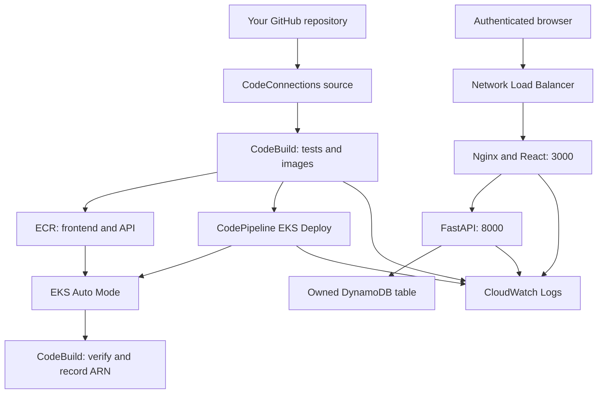
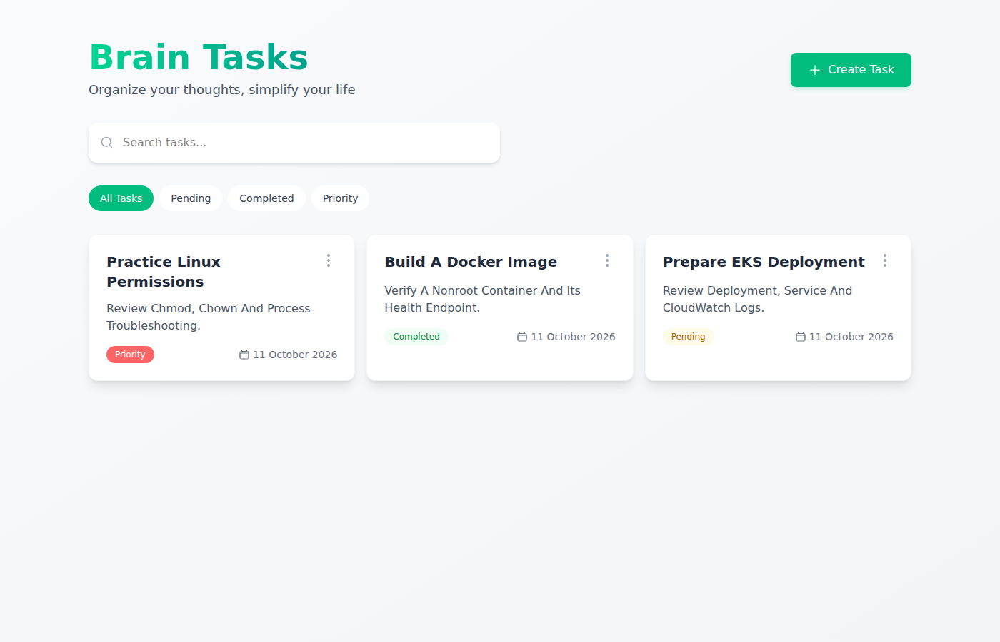

# Brain Tasks: React deployment on AWS EKS

This project packages the supplied compiled React application on **port 3000**, builds immutable container releases in CodeBuild, stores them in ECR, and deploys them using CodePipeline's native **EKS Deploy action**. A final verification stage records the live application URL and load balancer ARN.

**Delivery status:** source and validation records are prepared in your GitHub course repository on branch `brain-tasks-deployment`, under `projects/brain-tasks-deployment`. AWS provisioning still requires authenticated account access. No live cluster, successful AWS pipeline execution or load balancer ARN is claimed. See [VALIDATION.md](docs/VALIDATION.md).

## Why the supplied app needs a small API

The [upstream repository](https://github.com/Vennilavanguvi/Brain-Tasks-App) intentionally contains only `dist/`; it has no React source, `package.json`, or npm build. The compiled app calls a shared MockAPI service that returned HTTP 404 during inspection.

The original `dist/` is preserved. `scripts/prepare-dist.py` creates a deployment copy, replaces exactly five known API URLs with `/api/v1/tasks`, refreshes the list after create/update/delete operations, and updates the JavaScript content hash and HTML reference. Guarded substitutions fail if the known upstream code changes. A small FastAPI backend stores tasks in your own DynamoDB table. Numeric IDs preserve compatibility with the frontend's edit screen. The backend never uses the unavailable shared API.

Nginx protects the UI and API with HTTP Basic authentication. The backend has an internal Kubernetes Service and uses EKS Pod Identity to access only its task table. This is a single-user project, with one shared password and task collection; multiple independent user accounts would require an application authentication and authorization layer.

## Architecture



Terraform creates a two-AZ VPC, private node subnets, public load balancer subnets, NAT gateways, EKS Auto Mode, CloudWatch and metrics add-ons, two ECR repositories, DynamoDB, an encrypted artifact bucket, IAM roles, CodeBuild projects and a V2 pipeline. Auto Mode supplies the load balancer controller and compute management.

## Repository files

| Path | Purpose |
|---|---|
| `dist/` | Unmodified compiled frontend from the supplied repository |
| `Dockerfile`, `nginx/` | Nonroot Nginx runtime, authentication, security headers, SPA routing and API proxy |
| `api/` | Task API, locked dependencies, backend Dockerfile and local database initializer |
| `docker-compose.yml` | Local frontend, API and DynamoDB demo |
| `k8s/` | Deployments, Services, autoscaling, disruption budgets and bootstrap RBAC |
| `infra/` | Terraform infrastructure and provider lock file |
| `buildspec.yml` | Tests, Docker build, smoke test, ECR push and manifest rendering |
| `buildspec.verify.yml` | Rollout, digest, health, authentication and NLB verification |
| `scripts/` | Bootstrap, build, render, verify and submission commands |
| `tests/` | Isolated API and release-artifact tests |
| `docs/` | Validation record, screenshot checklist and submission instructions |

The course repository also includes `.github/workflows/brain-tasks-validation.yml` to validate Docker and Terraform on a standard Ubuntu runner without AWS credentials. The AWS delivery pipeline remains Source → CodeBuild → native EKS Deploy → Verify.

### Local UI evidence

These are real browser screenshots with isolated task fixtures, before AWS deployment. The browser check passed task creation, editing, deletion, search, filtering and mobile rendering. See [all validation details](docs/VALIDATION.md).



[Create task screenshot](docs/screenshots/local-create-task.png) · [Mobile screenshot](docs/screenshots/local-mobile.png)

## 1. Run on your laptop

On Windows, use Docker Desktop with WSL 2 and run these Bash commands in your Ubuntu/WSL terminal. Install Git, Python 3.12 or 3.13, OpenSSL, Docker with Compose, and curl. The application images are built for Linux amd64.

```bash
git clone --branch brain-tasks-deployment https://github.com/Vijayalingamgithub/guvi-devops-course.git
cd guvi-devops-course/projects/brain-tasks-deployment
bash scripts/create-auth-file.sh
docker compose up --build -d
docker compose ps
curl --fail http://localhost:3000/healthz
```

Open **http://localhost:3000** and sign in with username `vijay` and the password you entered. To use another username, run `AUTH_USERNAME=yourname bash scripts/create-auth-file.sh` before starting Compose.

Create a task, edit it, search by title, filter by status, delete it, and refresh `/createTask` directly to verify SPA routing. Local DynamoDB runs in memory; local demo tasks disappear when its container is removed or restarted. The AWS deployment uses persistent DynamoDB with point-in-time recovery.

```bash
docker compose logs --tail=50 web api
docker compose down
```

To build and check the frontend image explicitly:

```bash
docker build --platform linux/amd64 -t brain-tasks:local .
bash scripts/smoke-test.sh brain-tasks:local
bash scripts/browser-test.sh brain-tasks:local
docker build --platform linux/amd64 -f api/Dockerfile -t brain-tasks-api:local .
```

The smoke script checks health, authenticated React routes, missing asset handling, unauthenticated rejection, security headers and the container's nonroot user. Its password is a disposable test fixture.

## 2. Push your complete code to GitHub

This project is prepared in your course repository's separate project branch. From the cloned course repository, use these CLI commands for subsequent updates:

```bash
git checkout brain-tasks-deployment
git add projects/brain-tasks-deployment
git commit -m "Update Brain Tasks deployment"
git push origin brain-tasks-deployment
```

The following alternative creates a standalone repository from a ZIP of the project folder. Set `project_directory="."` and update `github_repository`/`github_branch` in Terraform when using it. The supplied application repository belongs to the upstream author.

For an extracted ZIP with no `.git` directory:

```bash
git init -b main
git config user.name "YOUR NAME"
git config user.email "YOUR GITHUB EMAIL"
git add .
git commit -m "Deploy Brain Tasks with Docker EKS ECR and AWS CI/CD"
gh auth login
gh repo create brain-tasks-devops --private --source=. --remote=submission --push
```

For subsequent changes:

```bash
git add .
git commit -m "Update Brain Tasks deployment"
git push submission main
```

Grant your assessor access to the private repository, or explicitly make it public if required. Never commit AWS credentials, authentication files, Terraform state or real submission evidence containing account details.

## 3. Authenticate to AWS and configure Terraform

Use a dedicated learning account or project role with permission to create the described infrastructure. EKS, EC2 nodes, NAT gateways, NLB, CodeBuild, logs, storage and backups incur charges while active; this is not a free hosting setup. Review the Terraform plan and your AWS cost controls before applying it.

Install AWS CLI v2, Terraform 1.13.5 (or another compatible 1.10+ version), and kubectl matching the configured cluster minor version. AWS IAM Identity Center credentials avoid putting permanent keys in this repository.

```bash
aws configure sso --profile brain-tasks
aws sso login --profile brain-tasks
export AWS_PROFILE=brain-tasks
export AWS_REGION=ap-south-1
aws sts get-caller-identity
cp infra/terraform.tfvars.example infra/terraform.tfvars
```

Edit `infra/terraform.tfvars`:

| Setting | Value to supply |
|---|---|
| `github_repository` | `Vijayalingamgithub/guvi-devops-course` for the prepared branch |
| `github_branch` | `brain-tasks-deployment`; use `main` after merging its pull request |
| `project_directory` | `projects/brain-tasks-deployment`; use `.` for a standalone repository |
| `administrator_principal_arn` | Your actual IAM/SSO role ARN; do not paste the STS assumed-role session ARN |
| `administrator_cidrs` | Your current public IPv4 address with `/32` |
| `kubernetes_version` | A supported regional version with compatible add-ons; default `1.36` |
| `pipeline_enabled` | Keep `false` for the first apply |
| `github_connection_arn` | Existing AVAILABLE AWS connection ARN, or empty to create one |

With SSO, find your role under IAM Roles and copy its **IAM role ARN**, including its path. The CLI session ARN from `sts get-caller-identity` is not the value EKS access entries accept.

Check version and add-on availability before applying:

```bash
aws eks describe-cluster-versions --region ap-south-1
aws eks describe-addon-versions --addon-name metrics-server --kubernetes-version 1.36
aws eks describe-addon-versions --addon-name amazon-cloudwatch-observability --kubernetes-version 1.36
terraform -chdir=infra init
terraform -chdir=infra fmt -check
terraform -chdir=infra validate
terraform -chdir=infra plan -out=infra.tfplan
terraform -chdir=infra apply infra.tfplan
```

The committed lock file pins the AWS provider. Add-on versions are resolved to compatible current versions during the infrastructure plan; inspect changes when upgrading them. Local state is suitable for a one-person exercise. Before shared or recurring operational use, migrate state to an encrypted S3 backend with Terraform's S3 lockfile support.

Two NAT gateways are the default for availability. `single_nat_gateway=true` is a lower-cost lab option with an egress single point of failure. Auto Mode can add compute as workloads grow; monitor node pool use and set limits appropriate to your account.

## 4. Complete the AWS GitHub connection and cluster bootstrap

AWS CodeConnections is separate from connecting GitHub to ChatGPT. When Terraform creates a connection, it remains **PENDING** until you authorize the AWS GitHub app in the AWS console.

```bash
terraform -chdir=infra output github_connection_arn
```

In the AWS console, open Developer Tools → Settings → Connections, select that connection, and complete the GitHub authorization. Allow access to your project repository and verify the connection is AVAILABLE.

Run bootstrap using the same IAM/SSO role configured as cluster administrator:

```bash
bash scripts/bootstrap.sh
```

Bootstrap confirms an ACTIVE cluster, writes kubeconfig, creates the namespace, namespace-scoped deploy/read roles, API service account and table configuration, and prompts for the application password if its Secret does not exist. It does not print or commit the password.

```bash
aws eks describe-cluster --name brain-tasks-eks --query 'cluster.{name:name,status:status,version:version}'
kubectl get nodes -o wide
kubectl get nodepools
kubectl -n amazon-cloudwatch get pods
```

## 5. Enable and run the pipeline

After bootstrap and the AWS GitHub connection are ready, set `pipeline_enabled=true` in `infra/terraform.tfvars`.

```bash
terraform -chdir=infra plan -out=pipeline.tfplan
terraform -chdir=infra apply pipeline.tfplan
aws codepipeline get-pipeline-state --name brain-tasks-pipeline
```

Creating the pipeline starts its first execution. Subsequent pushes to the configured project branch trigger new executions. To start a deliberate rerun:

```bash
aws codepipeline start-pipeline-execution --name brain-tasks-pipeline
```

| Stage | What happens |
|---|---|
| Source | AWS CodeConnections reads your GitHub branch into `SourceArtifact` |
| Build | CodeBuild validates the supplied assets, runs isolated API/release and browser tests, builds and smoke-tests Nginx, builds the API, pushes both images, resolves their ECR digests and emits one complete manifest |
| Deploy | Native V2 CodePipeline **EKS** action applies `BuildArtifact/manifests.yaml` using kubectl in the private VPC |
| Verify | A separate VPC CodeBuild project waits for both rollouts, checks the deployed digests and at least two available replicas per app, checks HTTP health/authentication and records the actual active NLB ARN |

Build and verification use the managed Ubuntu image `aws/codebuild/standard:7.0`. The image builder has Docker privileged mode enabled; verification does not. CodeBuild's source type is `CODEPIPELINE` because GitHub is connected at the pipeline Source stage. The Build project has ECR write permissions and no cluster deployment access. The pipeline's EKS principal is mapped to namespace-scoped Kubernetes RBAC; verification has read permissions.

Queued pipeline execution prevents overlapping deployments. Image tags include the commit SHA and unique build ID, so rerunning an immutable release does not collide with an existing tag. The deployment uses SHA256 digests, not mutable `latest` tags.

## 6. Open the app and retrieve the ARN

```bash
kubectl -n brain-tasks get deployments,pods,services,hpa,pdb
bash scripts/get-load-balancer.sh
```

The output includes `http://ACTUAL_NLB_DNS_NAME:3000` and the **actual Network Load Balancer ARN**. The ARN is not a URL. Sign in using the application password set during bootstrap.

Only the configured administrator CIDRs and verification NAT gateway IPs are allowed to connect to the load balancer. Update the configuration when your IP changes, and add an assessor's specific CIDR if they need access. The generated manifest, not the raw template, contains this allowlist.

The Verify stage's `VerificationReport` artifact includes `submission.json`, cluster status, both deployment records, pod status, HPA output and the Service manifest. Download the report through the pipeline action's output artifact link and retain it with your submission.

### HTTPS before Internet production use

The port-3000 endpoint is for the restricted-IP assignment/lab. Basic authentication must use TLS for real Internet use. Supply an **ISSUED ACM certificate in the same region** through `acm_certificate_arn`, add DNS for a domain covered by that certificate pointing to the NLB, and use `https://YOUR_DOMAIN` on port 443. The renderer adds the TLS listener while the container continues listening on port 3000. Remove the HTTP listener from the Service for a TLS-only deployment after updating the verification script to check HTTPS through your domain.

## 7. CloudWatch logs and monitoring

| Log group | Content |
|---|---|
| `/aws/codebuild/brain-tasks-build` | Tests, Docker build, smoke checks and ECR pushes |
| `/aws/codepipeline/brain-tasks-pipeline` | Managed EKS deployment action output |
| `/aws/codebuild/brain-tasks-verify` | Rollout, HTTP and live ARN verification |
| `/aws/eks/brain-tasks-eks/cluster` | Control plane, audit and authentication logs |
| `/aws/containerinsights/brain-tasks-eks/application` | Nginx access/errors and API container output collected by Fluent Bit |

```bash
aws logs tail /aws/codebuild/brain-tasks-build --since 30m
aws logs tail /aws/codepipeline/brain-tasks-pipeline --since 30m
aws logs tail /aws/containerinsights/brain-tasks-eks/application --since 30m
kubectl -n brain-tasks logs deployment/brain-tasks --tail=50
kubectl -n brain-tasks logs deployment/brain-tasks-api --tail=50
```

Nginx logs structured JSON to stdout and errors to stderr. Request bodies, passwords, Authorization headers and query strings are excluded from its access log. The CloudWatch add-on sends container logs to CloudWatch and enables Container Insights. Browser JavaScript console errors require separate frontend telemetry; web-server logs do not automatically capture them. Retention defaults to 14 days.

## 8. Tests, screenshots and submission

```bash
python3 -m venv .local/venv
.local/venv/bin/pip install -r api/requirements.txt -r requirements-test.txt
.local/venv/bin/python -m pytest tests -q
python3 scripts/validate-dist.py
terraform -chdir=infra fmt -check
terraform -chdir=infra validate
```

See [VALIDATION.md](docs/VALIDATION.md) for actual results and limits. See [SUBMISSION.md](docs/SUBMISSION.md) for the screenshot checklist and exact remaining submission fields. Never substitute local screenshots for a successful AWS pipeline or live EKS evidence.

## 9. Rollback and cleanup

The Deploy action applies manifests; the Verify stage is what confirms readiness. A failed verification does not automatically roll back an existing Kubernetes release.

```bash
kubectl -n brain-tasks rollout history deployment/brain-tasks
kubectl -n brain-tasks rollout undo deployment/brain-tasks
kubectl -n brain-tasks rollout undo deployment/brain-tasks-api
kubectl -n brain-tasks rollout status deployment/brain-tasks
kubectl -n brain-tasks rollout status deployment/brain-tasks-api
```

For a durable rollback, render and deploy the known-good frontend/API digests together, then reconcile the Git branch so the next automatic run does not redeploy the unwanted version. ECR retains the newest 20 image releases; keep any older image needed for rollback.

For cleanup after assessment, first set `pipeline_enabled=false` and apply that change so pushes cannot redeploy the app. Export any task data/evidence you need. Then delete the application Service while the cluster is still running and wait for the NLB to be removed:

```bash
kubectl -n brain-tasks delete service brain-tasks
aws elbv2 describe-load-balancers
terraform -chdir=infra plan -destroy
terraform -chdir=infra destroy
```

ECR and the versioned artifact bucket deliberately have force deletion disabled. Terraform will refuse to remove them while they contain data. After reviewing their exact names and archiving needed evidence, remove their contents using the AWS console, including S3 versions/delete markers, then rerun destroy. This also deletes the task table and requests deletion of the artifact KMS key. Verify EKS nodes, NLB, NAT gateways, public IPs and remaining log groups/backups in the AWS console after cleanup.

## References

- [Upstream compiled application](https://github.com/Vennilavanguvi/Brain-Tasks-App)
- [CodePipeline EKS action reference](https://docs.aws.amazon.com/codepipeline/latest/userguide/action-reference-EKS.html)
- [EKS Auto Mode cluster creation](https://docs.aws.amazon.com/eks/latest/userguide/automode-get-started-cli.html)
- [Auto Mode NLB Service configuration](https://docs.aws.amazon.com/eks/latest/userguide/auto-configure-nlb.html)
- [CloudWatch observability add-on and Pod Identity](https://docs.aws.amazon.com/AmazonCloudWatch/latest/monitoring/install-CloudWatch-Observability-EKS-addon.html)
- [Supported EKS versions](https://docs.aws.amazon.com/eks/latest/userguide/kubernetes-versions.html)
- [EKS pricing](https://aws.amazon.com/eks/pricing/)
